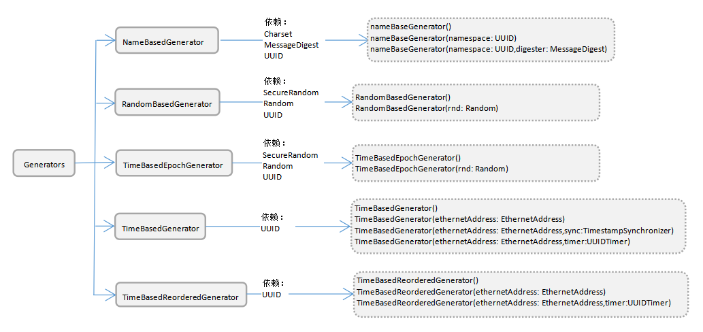

<div align="center">
<h1>uuid4cj</h1>
</div>

<p align="center">


</p>

##  介绍

UUID（通用唯一标识符），也称为GUID（全局唯一标识符）。UUID长度为128位，可以保证跨空间和时间的唯一性。

**特性**：

- 🚀 基于时间/位置生成 UUID 

- 💪 基于名称（MD5）生成 UUID

- 🚀 基于随机数生成 UUID

- 💪 基于名称（SHA1）生成 UUID

- 🌍 基于时间的重新排序生成 UUID

- 💡 基于时间纪元生成 UUID 

##  架构



1. 格式

      在其规范的文本表示中，UUID 的 16 个 8 位字节表示为 32 个十六进制数字，由连字符 '-' 分隔成五组显示，形式为“8-4-4-4-12”总共 36 个字符（32 个十六进制数字和 4 个连字符）。

      例如：

      ```
      123e4567-e89b-12d3-a456-426655440000
      ```

2. 变体

      变体字段确定UUID的布局。也就是说所有其他位的解释取决于变体的设置。变体字段由UUID的第8个字节的高3位。RFC 4122定义了4种变体：

      x表示不关心值。

      | Msb0 | Msb1 | Msb2 | 描述                                              |
      | ---- | ---- | ---- | ------------------------------------------------- |
      | 0    | x    | x    | 变体0，保留，NCS向后兼容性。                      |
      | 1    | 0    | x    | 变体1，RFC 4122 UUID定义，也就是2.1.2描述的布局。 |
      | 1    | 1    | x    | 变体2，保留，Microsoft Corporation向后兼容性。    |
      | 1    | 1    | x    | 保留供将来定义使用。                              |

      2.1 变体2布局

      | 名称                      | 长度 （字节） | 字节索引 | 说明                                                 |
      | ------------------------ | ------------ | ------- | --------------------------------------------------- |
      | time_low                  | 4             | 0-3      | 整数：低位 32 bits 时间                              |
      | time_mid                  | 2             | 4-5      | 整数：中间位 16 bits 时间                            |
      | time_hi_and_version       | 2             | 6-7      | 最高有效位中的 4 bits“版本”，后面是高 12 bits 的时间 |
      | clock_seq_hi_and_reserved | 1             | 8        | 最高有效位为 1-3 bits“变体”，后跟13-15 bits 时钟序列 |
      | clock_seq_low             | 1             | 9        | 时钟序列的低位                                       |
      | node                      | 6             | 10-15    | 48 bits 节点 ID                                      |

3. 版本

      对于变体1和变体2，标准中定义了5个版本。

      版本数值位与第6个字节的高4位，即time_hi_and_version 字段的第4到第7位。

      | Msb0 | Msb1 | Msb2 | Msb3 | Version | 意义                             |
      | ---- | ---- | ---- | ---- | ------- | -------------------------------- |
      | 0    | 0    | 0    | 1    | 1       | 基于时间的UUID                   |
      | 0    | 0    | 1    | 0    | 2       | 基于时间的UUID，DEC安全版本      |
      | 0    | 0    | 1    | 1    | 3       | 基于名称空间和MD5散列算法的UUID  |
      | 0    | 1    | 0    | 0    | 4       | 基于随机数的UUID                 |
      | 0    | 1    | 0    | 1    | 5       | 基于名称空间和SHA1散列算法的UUID |

      3.1 版本4算法

      版本4 UUID是从真正随机数或伪随机数生成UUID。

      算法如下：

      将时钟_seq_hi_and_reserve的两个最高有效位（位6和位7）分别设置为零和1。

      将time_hi_and_version字段的四个最高有效位（位12至15）设置为版本4版本号。

      将所有其他位设置为随机（或伪随机）选择的值。

4. 字符串形式

      4.1 标注形式

      ```
      UUID                   = time-low "-" time-mid "-"
                                    time-high-and-version "-"
                                    clock-seq-and-reserved
                                    clock-seq-low "-" node
            time-low               = 4hexOctet
            time-mid               = 2hexOctet
            time-high-and-version  = 2hexOctet
            clock-seq-and-reserved = hexOctet
            clock-seq-low          = hexOctet
            node                   = 6hexOctet
            hexOctet               = hexDigit hexDigit
            hexDigit =
                  "0" / "1" / "2" / "3" / "4" / "5" / "6" / "7" / "8" / "9" /
                  "a" / "b" / "c" / "d" / "e" / "f" /
                  "A" / "B" / "C" / "D" / "E" / "F"
      ```

      4.2 URN形式

      ```
      urn:uuid:f81d4fae-7dec-11d0-a765-00a0c91e6bf6
      ```

### 源码目录

```shell
.
├── doc
├── src
│   ├── uuid4cj
│   └── package.cj
└── test
│   ├── FUZZ
│   ├── HLT
│   ├── LLT
│   ├── Reliability
│   └── UT
├── CHANGELOG.md
├── LICENSE.txt
├── cjpm.toml
├── README.md
├── README.OpenSource
```

- `doc` 存放库的设计文档、使用文档、LLT 用例覆盖报告
- `src` 是库源码目录
- `test` 存放 FUZZ 测试用例、HLT 测试用例、LLT 自测用例、Reliability 测试用例和 UT 单元测试用例

### 接口说明

主要核心类和全局函数说明,详情见 [API](./doc/feature_api.md)

##  使用说明

### 编译
    ```
    cjpm build
    ```

### 功能示例

#### 基于名称 MD5 生成 UUID 使用样例

```cangjie
import uuid4cj.uuid4cj.*

main() {   
    var namespace: UUID = NameBasedGenerator.NAMESPACE_DNS
    var name: NameBasedGenerator = Generators.nameBasedGenerator(namespace, MessageDigest(DigestType.MD5))
    let uuid: UUID = name.generate("helloworld")
    println("UUIDType: ${name.getType().raw()}")
    println("基于MD5摘要生成的UUID: ${uuid.toString()}")
    return 0
}
```
执行结果如下：

```
UUIDType: 3
基于MD5摘要生成的UUID: c464cb54-da68-36d5-a15b-6ebbd2bd02ec
```

#### 基于名称 SHA1 生成 UUID 使用样例

```cangjie
import uuid4cj.uuid4cj.*

main() {   
    var name: NameBasedGenerator = Generators.nameBasedGenerator()
    let uuid: UUID = name.generate("helloworld")
    println("UUIDType: ${name.getType().raw()}")
    println("基于SHA1摘要生成的UUID: ${uuid.toString()}")
    return 0
}
```
执行结果如下：

```
UUIDType: 5
基于SHA1摘要生成的UUID: 6adfb183-a4a2-594a-af92-dab5ade762a4
```

```cangjie
import uuid4cj.uuid4cj.*

main() {   
    var namespace: UUID = NameBasedGenerator.NAMESPACE_DNS
    var name: NameBasedGenerator = Generators.nameBasedGenerator(namespace)
    let uuid: UUID = name.generate("helloworld")
    println("UUIDType: ${name.getType().raw()}")
    println("基于SHA1摘要生成的UUID: ${uuid.toString()}")
    return 0
}
```
执行结果如下：

```
UUIDType: 5
基于SHA1摘要生成的UUID: 4684684f-d5ae-5e83-95e4-adecc6bb2135
```

```cangjie
import uuid4cj.uuid4cj.*

main() {   
    var namespace: UUID = NameBasedGenerator.NAMESPACE_DNS
    var name: NameBasedGenerator = Generators.nameBasedGenerator(namespace, MessageDigest(DigestType.SHA1))
    let uuid: UUID = name.generate("helloworld")
    println("UUIDType: ${name.getType().raw()}")
    println("基于SHA1摘要生成的UUID: ${uuid.toString()}")
    return 0
}
```
执行结果如下：

```
UUIDType: 5
基于SHA1摘要生成的UUID: 4684684f-d5ae-5e83-95e4-adecc6bb2135
```
#### 基于随机数 生成 UUID 使用样例

```cangjie
import uuid4cj.uuid4cj.*
import crypto.crypto.SecureRandom
import std.random.*

main() {  
    
    let c: RandomBasedGenerator = Generators.randomBasedGenerator()
    let uuid: UUID = c.generate()

    println("基于SecureRandom随机生成的UUID: ${uuid.toString()}")
    if(uuid.version() != 4) {
        return -1
    }
    return 0
}
```
执行结果如下：

```
UUIDType: 4
基于SecureRandom随机生成的UUID: 1c290f65-05c7-4426-a90f-6505c7f426e6
```
```cangjie
import uuid4cj.uuid4cj.*
import crypto.crypto.SecureRandom
import std.random.*

main() {  

    let _random: Random = Random()
    let b: RandomBasedGenerator = Generators.randomBasedGenerator(_random)
    let uuid: UUID = b.generate()
    println("基于Random随机生成的UUID: ${uuid.toString()}")
    if(uuid.version() != 4) {
        return -1
    }
    return 0
    
}
```
执行结果如下：

```
UUIDType: 4
基于Random随机生成的UUID: c259ecfd-bbf0-4e28-8ea2-03d10194b80a
```
```cangjie
import uuid4cj.uuid4cj.*
import crypto.crypto.SecureRandom
import std.random.*

main() {  
    
    let _sRandom: SecureRandom = LazyRandom.sharedSecureRandom();
    let a: RandomBasedGenerator = Generators.randomBasedGenerator(_sRandom)
    let uuid: UUID = a.generate()
    println("基于SecureRandom随机生成的UUID: ${uuid.toString()}")
    if(uuid.version() != 4) {
        return -1
    }
    return 0
}
```
执行结果如下：

```
UUIDType: 4
基于SecureRandom随机生成的UUID: 1c290f65-05c7-4426-a90f-6505c7f426e6
```

#### 基于时间的重新排序生成 UUID 使用样例

样例一

```
import uuid4cj.uuid4cj.*

main() {  
    var time: TimeBasedReorderedGenerator = Generators.timeBasedReorderedGenerator()
    let uuid: UUID = time.generate()
    println("UUIDType: ${time.getType().raw()}")
    println("生成的UUID: ${uuid.toString()}")
    return 0
}
```
执行结果如下：

```
UUIDType: 6
生成的UUID: 1eddccb0-d3a9-6c62-aa57-558bc85f0a6d
```

样例二

```
import uuid4cj.uuid4cj.*

main() {  
    var address: EthernetAddress = EthernetAddress("87:f5:93:06:D3:0C")
    var time: TimeBasedReorderedGenerator = Generators.timeBasedReorderedGenerator(address)
    var uuid: UUID = time.generate()
    println("UUIDType: ${time.getType().raw()}")
    println("生成的UUID: ${uuid.toString()}")
    return 0
}
```
执行结果如下：

```
UUIDType: 6
生成的UUID: 1eddccc0-0829-64ae-aaf8-87f59306d30c
```

样例三

```
import uuid4cj.uuid4cj.*
import crypto.crypto.SecureRandom

main() {  
    var address: EthernetAddress = EthernetAddress("87:f5:93:06:D3:0C")
    var timer: UUIDTimer = UUIDTimer(SecureRandom(), Option<FileBasedTimestampSynchronizer>.None)
    var time: TimeBasedReorderedGenerator = Generators.timeBasedReorderedGenerator(address, timer)
    var uuid: UUID = time.generate()
    println("UUIDType: ${time.getType().raw()}")
    println("生成的UUID: ${uuid.toString()}")
    return 0
}
```
执行结果如下：

```
UUIDType: 6
生成的UUID: 1eddccca-4e78-6aa5-96c5-87f59306d30c
```

#### 基于时间纪元生成 UUID 使用样例

样例一

```
import uuid4cj.uuid4cj.*

main() {  
    var time: TimeBasedEpochGenerator = Generators.timeBasedEpochGenerator()
    let uuid: UUID = time.generate()
    println("UUIDType: ${time.getType().raw()}")
    println("生成的UUID: ${uuid.toString()}")
    return 0
}
```
执行结果如下：

```
UUIDType: 7
生成的UUID: 01878d39-54c2-7db7-aa02-cb98e6732ee4
```

样例二

```
import uuid4cj.uuid4cj.*
import std.random.*

main() {  
    var time: TimeBasedEpochGenerator = Generators.timeBasedEpochGenerator(Random())
    var uuid: UUID = time.generate()
    println("UUIDType: ${time.getType().raw()}")
    println("生成的UUID: ${uuid.toString()}")
    return 0
}
```
执行结果如下：

```
UUIDType: 7
生成的UUID: 01878d39-58d2-7162-80e2-a635375f7673
```

#### 基于时间+默认地址生成 UUID 使用样例

样例一

```
import uuid4cj.uuid4cj.*

main() {  
    let time: TimeBasedGenerator = Generators.timeBasedGenerator()
    let uuid: UUID = time.generate()

    println("UUIDType: ${time.getType().raw()}")
    println("生成的UUID: ${uuid.toString()}")
    return 0
}
```
执行结果如下：

```
UUIDType: 1
生成的UUID: 01878d39-54c2-7db7-aa02-cb98e6732ee4
```

样例二

```
import uuid4cj.uuid4cj.*
import crypto.crypto.SecureRandom
import std.random.*
import std.time.*
import std.fs.*
import std.format.Formatter

main() {  
    let filePath1: String = "./ggg_readTest.txt"

    var file1: File = openFile(filePath1)


    let filePath2: String = "./zzz_readTest.txt"

    var file2: File = openFile(filePath2)


    var oFile: Option<FileBasedTimestampSynchronizer> =  FileBasedTimestampSynchronizer(file1, file2)
    var ethernetAddress: Option<EthernetAddress> =  EthernetAddress("87:f5:93:06:d3:0c")

    let a: TimeBasedGenerator = Generators.timeBasedGenerator(ethernetAddress, oFile)

    let b: TimeBasedGenerator = Generators.timeBasedGenerator(Option<EthernetAddress>.None, Option<FileBasedTimestampSynchronizer>.None)

    let uuid: UUID = a.generate()

    let uuid2: UUID = b.generate()

    println("UUIDType: ${a.getType().raw()}")
    println("生成的UUID: ${uuid.toString()}")

    println("UUIDType: ${b.getType().raw()}")
    println("生成的UUID2: ${uuid2.toString()}")

    file1.close()
    file2.close()
    return 0
}
public func openFile (filePath: String): File {
    var file: File

    if (File.exists(filePath)) {
        file = File(filePath, OpenOption.Open(true, true))
    } else {
        file = File(filePath, OpenOption.Create(true))
    }
    return file
}
```
执行结果如下：

```
UUIDType: 1
生成的UUID: 01878d39-58d2-7162-80e2-a635375f7673

UUIDType: 1
生成的UUID2: 01878d39-58d2-7162-80e2-a635375f7674
```

样例三

```
import uuid4cj.uuid4cj.*
import crypto.crypto.SecureRandom
import std.random.*
import std.time.*

main() {

    var timer = UUIDTimer(SecureRandom(), Option<FileBasedTimestampSynchronizer>.None)
    let a: TimeBasedGenerator = Generators.timeBasedGenerator(Option<EthernetAddress>.None, timer)

    let b: TimeBasedGenerator = Generators.timeBasedGenerator(Option<EthernetAddress>.None, Option<UUIDTimer>.None)


    let uuid: UUID = a.generate()

    let uuid2: UUID = b.generate()

    println("UUIDType: ${a.getType().raw()}")
    println("生成的UUID: ${uuid.toString()}")

    println("UUIDType: ${b.getType().raw()}")
    println("生成的UUID2: ${uuid2.toString()}")
    
    return 0
}
```
执行结果如下：

```
UUIDType: 1
生成的UUID: 01878d39-58d2-7162-80e2-a635375f7675

UUIDType: 1
生成的UUID2: 01878d39-58d2-7162-80e2-a635375f7676
```

## 约束与限制

在下述版本验证通过：

    Cangjie Version: 0.58.3

## 开源协议
本项目基于 [Apache License 2.0](./LICENSE)，请自由的享受和参与开源。

## 参与贡献

欢迎给我们提交PR，欢迎给我们提交Issue，欢迎参与任何形式的贡献。